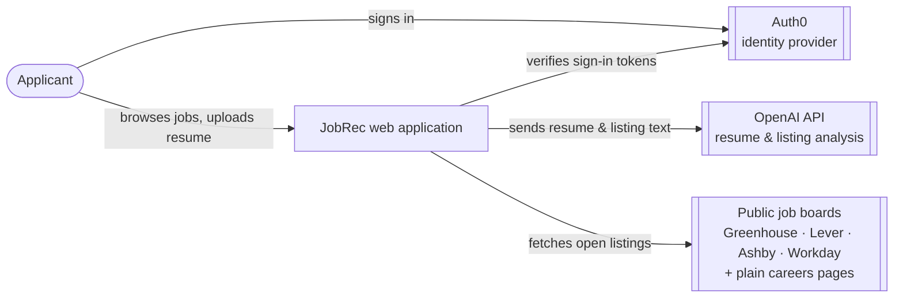
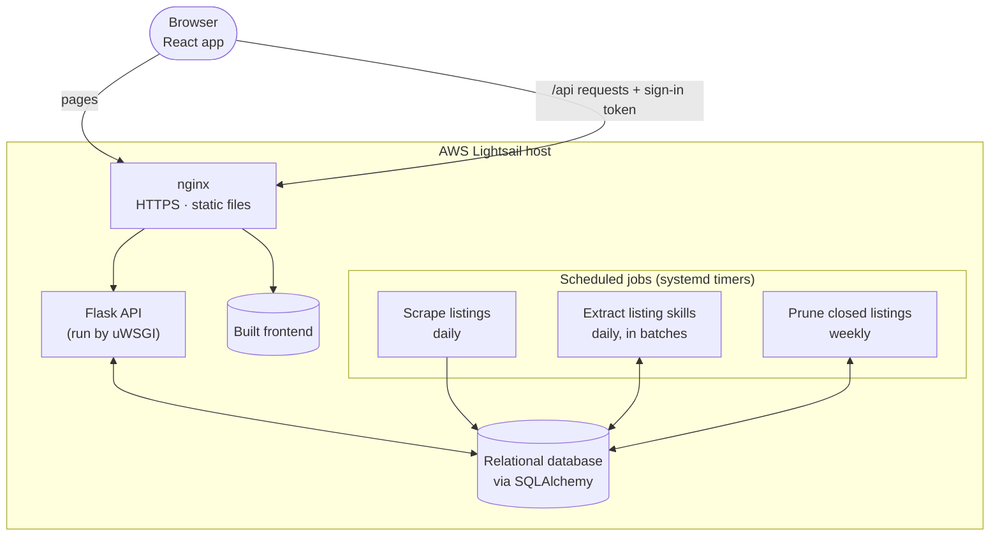
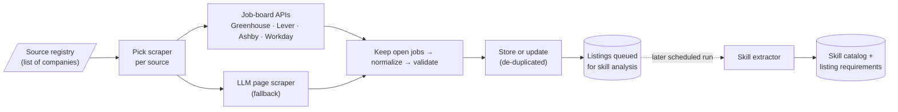
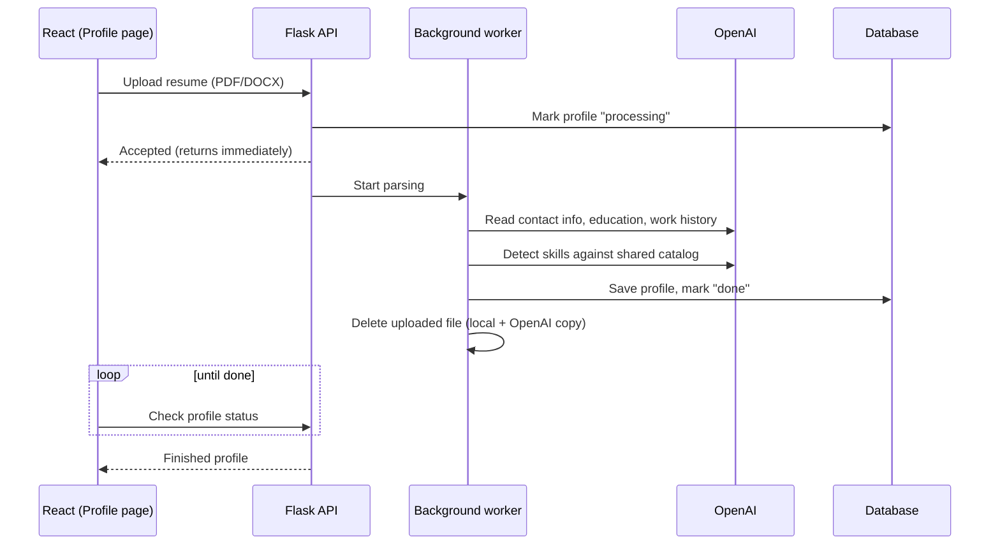
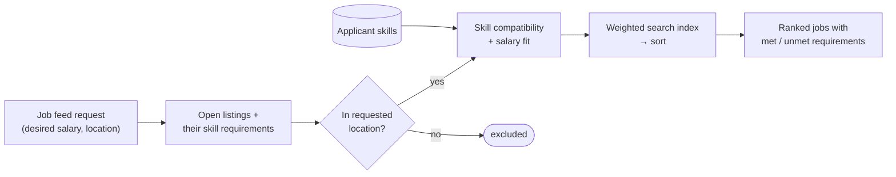
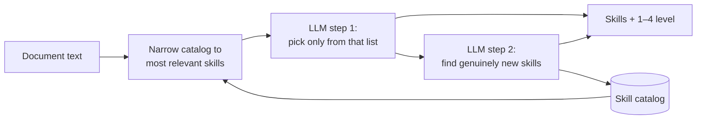

# Explanation: JobRec

> **Audience:** developers and technically capable readers who want to understand *why* JobRec is built the way it is.
> For step-by-step use, see the [Tutorial](tutorial.md) and [How-To Guide](how-to.md). For exact endpoints, tables, formulas, and settings, see the [Reference](reference.md).

---

## System Overview

### What JobRec is for

JobRec is an **applicant-focused job board**. Most job platforms are built around employers, and applicants have to work out for themselves whether they qualify. JobRec reverses this:

- The applicant uploads a **resume** instead of filling out a long profile.
- The system works out **which skills the applicant has** and **which skills each job needs**, both on the same 1–4 proficiency scale.
- Jobs are ranked by **how well the applicant actually matches**, and the reasons are shown: which requirements are met and which aren't.

Matching accuracy is what sets JobRec apart from existing platforms, and most of the design decisions below follow from it.

### What the system does

| Concern | What it means | When it runs |
|---|---|---|
| **Collecting listings** | Pull open jobs from company job boards, clean and de-duplicate them, and store them | Daily, in the background |
| **Understanding documents** | Turn resumes and job descriptions into structured skill data that can be compared | On resume upload; daily for new or changed listings |
| **Matching** | Score stored listings against the applicant's skills and salary goal, then rank them | Each time the applicant opens their job feed |
| **Keeping listings fresh** | Remove jobs that have closed | Weekly |

The key architectural idea is that **expensive work happens ahead of time**. Scraping and LLM skill extraction run on schedules, separate from user requests, so ranking a feed is just arithmetic over data already in the database (NFR-001 Fast Webpage Performance, NFR-004 Data Storage).

JobRec is live at [jobrec.thecoolsite.org](https://jobrec.thecoolsite.org/) and redeploys automatically whenever `main` changes.

---

## Architecture Diagrams

> These diagrams update the System Context and Container diagrams from our SD I [Design Document](Design%20Document.pdf) to match the system as built. [Design Decisions](#design-decisions) explains what changed.

### 1. System context

### 2. Containers and deployment

Everything runs on one Linux host. nginx is the front door and splits traffic between the static frontend and the Python API.

### 3. Listing ingestion (background)

### 4. Resume → profile (on demand)

### 5. Matching (per request)

---

## Key Components

### Frontend (React + Vite + Tailwind)

- A **single-page app** for onboarding, the profile, the job feed, job details, and search.
- Uses **Auth0's React SDK** to sign users in and attach a token to every API call.
- Contains **no matching logic**: compatibility scores and requirement lists come from the API. Search filters currently run in the browser over jobs that are already loaded.
- Is compiled to static files that nginx serves directly.

### API layer (Flask, behind uWSGI and nginx)

- Every user route **requires a valid Auth0 token**, and requests are tied to the user by their Auth0 ID. The backend never handles passwords.
- Routes are thin: they validate input and pass the work to the matching, storage, or parsing components.
- **Resume upload returns right away.** Parsing runs in the background and the frontend polls for the result, so a slow LLM call doesn't tie up a web worker.

### Resume parsing

- Parsing happens in two passes:
  1. A **structured LLM read** of the resume extracts contact details, education, work history, projects, and links, and the output is forced into a fixed schema.
  2. **Skill detection** runs through the *same* detector used for job listings, so resume skills and listing skills share one vocabulary.
- **Privacy by design (NFR-003):** uploads get random names and are deleted, both locally and on OpenAI, once parsing ends, whether it succeeded or failed. Only the structured profile is kept.

### Skill detection

This is the core of matching accuracy, and resumes and listings both go through it.

- **One shared catalog** of canonical skill names, so different spellings of a skill don't split matches.
- **Narrowing first.** A lightweight keyword-relevance ranker picks a short candidate list, so LLM cost doesn't grow with the size of the catalog.
- **Constrained matching.** In step 1 the model can only answer with names from the candidate list, which prevents invented near-synonyms.
- **Discovery.** Step 2 adds skills that are truly new to the catalog, so the vocabulary keeps up with the job market without manual upkeep.
- **Deferred for listings.** Scraping only marks new or changed listings as pending, and a separate scheduled job analyzes them in fixed-size batches.

### Listing ingestion

- **One interface, many sources.** Every scraper returns the same standard listing model, so nothing downstream needs to know where a job came from.
- **Registry-driven.** Adding a company means adding one line to a config file, not writing code.
- **Structured APIs first** (Greenhouse, Lever, Ashby, Workday). An **LLM fallback** reads plain careers pages that aren't on a supported board.
- **Fault isolation.** A failing source is logged and skipped, and one malformed job never discards the rest of its board.

### Storage and de-duplication

- The same jobs come back on every scrape. Each listing gets a stable identity (the source's own job ID where there is one, otherwise its link or details), and known jobs are **updated in place** rather than inserted again.
- A changed job description sends the listing back for skill analysis.

### Matching and ranking

Ranking follows our [Job Matching Algorithm Specification](Job%20matching/Job%20Matching%20Algorithm%20Specification.pdf):

- **Skill compatibility:** how well the applicant's proficiencies cover the listing's requirements, with more important requirements weighted more heavily. A perfect match scores 1.0.
- **Salary fit:** offered pay compared with the applicant's desired pay, with a cap. Listings that don't disclose pay get a low default score.
- **Search index:** a weighted sum that favors compatibility (70%) over salary (30%).
- **Location filters; it doesn't score.** It decides whether a job appears, never how high it ranks.
- Every result includes its **met/unmet requirements**, which is how the UI explains the ranking.

### Pruning closed listings

- **Nominate, then confirm.** A listing becomes a candidate if its company's latest scrape didn't include it, or if nothing has reported it for a week. It is deleted only when its application link gives **positive evidence** that the job is closed.
- A failed or ambiguous check leaves the listing in place.

---

## Design Decisions

### Python and Flask

- Python is the language the team knows best, and it has the strongest tooling for LLMs, PDF/DOCX parsing, and data work.
- The API is a small set of JSON routes, so a lightweight framework is enough. Django would bring an ORM, admin panel, and templating that we would either replace or never use.

### A separate React frontend

- Keeping the UI separate from the API let frontend and backend work proceed in parallel, and lets nginx serve the UI as plain static files.
- React is the framework the team has the most experience with.

### Auth0 instead of our own accounts

- Writing authentication ourselves is high-risk and doesn't set JobRec apart.
- Auth0 provides standard OAuth/OIDC, social login, and password resets. JobRec **never stores passwords**.

### SQLAlchemy and a database that can be swapped

- The SD I design named MySQL. What was built uses an ORM, so the same code runs on **SQLite** (no-setup local development and fast tests) or **PostgreSQL**, chosen by a single connection setting.
- The storage layer handles the differences between the two explicitly, and CI runs the storage tests against a real Postgres instance so both stay supported.
- A **relational model** suits the data: users, skills, and listings are linked many-to-many, with a proficiency level on each listing–skill link.
- The user profile is stored as a **JSON document**, because it is always read and written whole and its shape changed often during development.

### Dynamic skill catalog with an LLM matcher (Design Trade #1)

| Option | Accuracy | Maintenance | Cost / speed |
|---|---|---|---|
| Static list + word matching | Few false positives, many misses | Needs human upkeep | Cheapest |
| Snapshot list + LLM, refreshed monthly | Better recall | Low | Expensive |
| **Dynamic list + LLM (chosen)** | **Best recall and detail** | **Grows on its own** | Most expensive |

- Accuracy and level of detail had the highest weights, because recommendation quality depends on them directly (FR-001, FR-006).
- The built version adds two safeguards the original study didn't include. **Narrowing the catalog** keeps cost bounded, and **constrained output** cuts false positives and synonym drift (FR-004 Hallucination Minimization).

### Hybrid, API-first ingestion (Design Trade #2)

- **Structured APIs** are more accurate, cheaper, and less brittle than parsing HTML, so they are used wherever they exist.
- The **LLM fallback** is only for pages that aren't on a supported board, and supported boards are refused by the fallback to keep cost down.
- A **verbatim rule** means a value the LLM reads is kept only if that text actually appears on the page, so empty fields stay empty instead of being guessed (FR-004).
- **Changed from SD I:** the planned headless-browser layer (Playwright) was not built.

### Rule-based ranking (Design Trade #3, revisited)

- SD I chose a **hybrid semantic + feature-based** ranker. What's built is the **rule-based formula** from the Matching Algorithm Specification, which the team wrote after CDR feedback that matching was under-defined.
- The rule-based approach won out in practice because it is:
  - **Explainable:** every score breaks down into specific met and unmet requirements.
  - **Testable:** fixed weights give results that unit tests can check.
  - **Free of training data:** a learned or semantic model needs labeled outcomes we don't have yet.
- Semantic similarity remains a future improvement.

### Location as a filter, not a score

- A user who widens the search radius *wants* jobs that are farther away. Penalizing distance would undo that choice, so location only includes or excludes listings.

### Separate schedules for scraping, extraction, and pruning

- **Scraping is cheap and network-bound. Skill extraction is costly and depends on the LLM.** Keeping them apart means:
  - A large batch of new listings can't cause a spike in OpenAI spending, because extraction handles a fixed batch per run.
  - Scraping still succeeds when OpenAI is down; listings just wait in the queue.
  - Each job can be retried and monitored on its own, and a scrape where any source fails, or that leaves the database empty, reports itself as failed.
- **Pruning runs weekly** and reads job pages slowly and politely. It doesn't need to run every day, because closed listings do little harm for a few days.
- **systemd timers** need no extra infrastructure, unlike a task queue such as Celery.

### Deployment

- **nginx → uWSGI → Flask.** Flask's built-in server is for development only. uWSGI provides multiple worker processes, and nginx handles HTTPS and static files. SD I named Gunicorn; uWSGI is installed only at deploy time so that Windows development setups keep working.
- **A single Lightsail host** is much cheaper and simpler than a managed platform at course scale, and the team already knew AWS.
- **CI/CD on every merge.** GitHub Actions pulls secrets from AWS, deploys, rebuilds the frontend, and restarts services. Separate workflows run backend tests and linting, Postgres storage tests, frontend tests, and SBOM generation.

### Code organized by responsibility

- Each module does one job: scrape, clean, validate, store, extract skills, rank, check links, or prune. This keeps changes local; adding a job board, for example, touches only a new scraper and the registry.
- Scrapers accept an injected HTTP client, so tests run against saved fixtures and never touch the network.

---

## Tradeoffs and Limitations

### Accuracy depends on the LLM

| Tradeoff | Consequence |
|---|---|
| Rankings are only as good as skill extraction | Wrong proficiency levels lead directly to wrong rankings. Users can remove wrong skills from their own profile, but listing skills can't be corrected by hand. |
| A coarse 1–4 scale | Simple and consistent, but missing several minor skills can count as much as missing one critical skill. The spec suggests a finer scale or weighting important skills more heavily. |
| The catalog grows without review | Near-duplicate skills can build up over time. |
| Third-party processing | Resumes are sent to OpenAI. Files are deleted afterwards, but this still relies on an outside processor (NFR-003). |

### Cost and freshness

- Analyzing a listing takes LLM calls, so extraction is batched. A large set of new listings can therefore take **several days** before it gets skill data and ranks properly.
- Very large Workday boards are only **partly scraped**, which is one reason pruning never treats "missing from a scrape" as proof that a job closed.
- Because pruning is weekly and cautious, a closed job can stay visible for **up to about a week**.

### Scalability

- **Ranking happens per request.** Every feed load scores all open listings in application code. This works at current scale but grows linearly with listing count; precomputed scores or database-side scoring would be needed at larger scale.
- **There is a single host.** The web server and scheduled jobs share one machine, with no horizontal scaling or failover, a tradeoff of resilience for cost and simplicity.
- **Rate limiting is defined but not enforced.** The nginx config sets up a per-IP limit, but no route applies it yet, so the API has no protection against request floods.
- **Resume parsing runs in a background thread** inside the web worker. If the worker restarts mid-parse, that work is lost and the user must re-upload. A durable job queue would fix this.

### Coverage

- Careers pages that need **JavaScript to render** aren't supported, because the headless-browser layer was cut to reduce complexity and server load.
- **Location matching is text-based**, not geographic: a search for "Indianapolis" won't find "Carmel, IN". The geocoding and radius search from SD I isn't built yet.

### Planned features

Some features from the original design exist only as placeholders: skill-gap analysis, candidate percentile ranking, server-side search filters and pagination, full profile editing, and saving "report this listing" submissions. The current architecture accounts for them (the data they need is already stored), but they are not yet part of the system's behavior.

---

*Related documents:* [Tutorial](tutorial.md) · [How-To Guide](how-to.md) · [Reference](reference.md) · [SD I Design Document](Design%20Document.pdf) · [Job Matching Algorithm Specification](Job%20matching/Job%20Matching%20Algorithm%20Specification.pdf)
